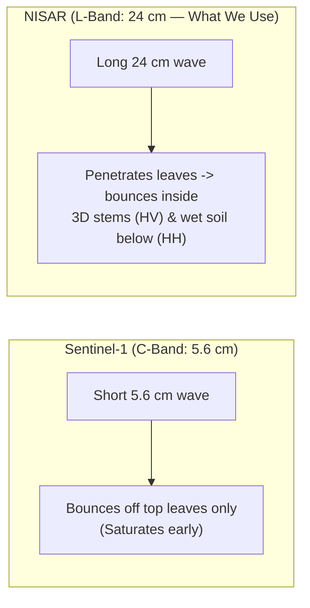

# EARTH RHYTHM — The Complete Zero-to-Expert Guide for Presenting to Judges

> **Purpose of this document:** Even if you have never studied radar, remote sensing, or geospatial software before, reading this guide from top to bottom will teach you **every physical concept, every acronym (`SAR`, `NISAR`, `L-Band`, `HH`, `HV`, `dB`, `ENL`, `NESZ`, `GCOV`, `GUNW`, `COG`), every scientific discovery we made, and every single button, color, and chart on the GUI**.

---

## Part 1: The 30-Second Elevator Pitch (Plain English)

If a judge walks up to your table and asks, *"What did you build?"*, here is the big picture in plain English:

1. **What is the problem?**
   In arid regions like Egypt, life depends on irrigated agriculture fed by the Nile. Normally, scientists track crops using optical satellites (which take normal photos like a phone camera). Put simply: **optical cameras only see the green color of the very top leaves** (and are blinded by clouds or dust). They cannot see *under* the leaves, they cannot tell if a farmer just flood-irrigated a harvested field, and they cannot measure the 3D woody structure of crops.
2. **What is our solution?**
   We built **Earth Rhythm**, a scientific processing pipeline and interactive web observatory using **real data from NISAR** — the brand-new NASA + ISRO (Indian Space Research Organisation) radar satellite launched to study Earth. Over **Fayoum Oasis, Egypt**, we analyzed **10 consecutive radar passes** (every 12 days from June 23 to October 21, 2026).
3. **What is our big discovery?**
   NISAR sends radar waves in two channels simultaneously: **`HH`** and **`HV`**.
   - We proved that **`HV` acts as a 3D vegetation biomass sensor** (tracking `764 km²` of summer crop growth and `595 km²` of harvest), while **`HH` acts as a soil-moisture, plowing, and water-wave sensor**.
   - Most importantly, we discovered **`440.7 km²` of agricultural land where `HH` and `HV` tell opposite or single-channel stories**! For example, when farmers harvest a summer crop and immediately flood-irrigate the bare soil for autumn planting, **`HV` drops by `-4.7 dB`** (because the plants are gone) while **`HH` shoots up by `+5.0 dB`** (because wet soil reflects radar strongly). A traditional single-channel radar would mistake that flooded bare dirt for crop growth — **NISAR's dual-polarization separates them!**

---

## Part 2: Radar & SAR 101 — Every Technical Term Explained from Scratch

### 1. Optical Satellites vs. SAR (Synthetic Aperture Radar)
- **Optical Satellites (like Sentinel-2 or Landsat):** Passive cameras that rely on sunlight reflecting off the top millimeter of the Earth. They cannot see at night, cannot see through clouds, and only measure surface color (like green chlorophyll via `NDVI`).
- **SAR (Synthetic Aperture Radar):** An **active** sensor. The satellite carries its own microwave transmitter (like a powerful radar flashlight). It shoots pulses of radio waves toward the Earth at an angle (off-nadir), and listens to the **echo ("backscatter")** that bounces back.
  - *"Synthetic Aperture"* just means the satellite uses its forward motion along its orbit to mathematically combine thousands of radar pulses, acting as if it had a giant kilometer-wide antenna in space so it can see `10-meter` details on the ground!

### 2. What is NISAR and Why is "L-Band (`24 cm`)" Special?
- **NISAR:** Stands for **NASA-ISRO Synthetic Aperture Radar**.
- **Wavelength (`L-Band = 24 cm`):** Radar waves come in different wavelengths:
  - Older radar satellites like Europe's **Sentinel-1** use **C-Band (`5.6 cm` wavelength)** — about the length of your pinky finger. Because `5.6 cm` waves are small, they bounce off the very top leaves and twigs of crops and get saturated quickly.
  - **NISAR uses L-Band (`24 cm` wavelength, `1.24 GHz`)** — about the length of a ruler! Because `24 cm` waves are much longer, they **pass right through small top leaves and penetrate deep into the crop canopy, stems, branches, and underlying soil**.

---

### 3. What is Backscatter ($\gamma^0$, "Gamma-Naught")? How Do Surfaces Bounce Radar?
When NISAR shoots a radar pulse at the ground at an angle, how much energy bounces **back toward the satellite** depends on the geometry and wetness of the ground. We measure this normalized echo strength as **$\gamma^0$ ("Gamma-Naught")**:

1. **Mirror Reflection ("Specular Reflection" — Very Dark, `-23` to `-25 dB`):**
   - *Where:* Calm open water (**Lake Qarun**, **Wadi El Rayan**) or ultra-smooth flat desert sand sheets.
   - *Physics:* Because the satellite points at an angle, a smooth flat surface acts like a mirror and reflects the radar beam **away into space** in the opposite direction. Almost zero energy returns to the satellite, so the pixel looks **pitch black**.
2. **Rough Surface Bounce ("Bragg / Surface Scattering" — Medium Brightness, `-18` to `-10 dB`):**
   - *Where:* Bare plowed farm fields, rocky/gravelly desert, or **wind-rippled lake water**.
   - *Physics:* Small ridges, clods of dirt, or wind-driven capillary waves scatter part of the radar beam back toward the satellite.
   - *Role of Water/Moisture ("Dielectric Constant"):* Dry soil absorbs or weakly reflects radar. **Wet soil** has a huge electrical permittivity ("dielectric constant"), acting like liquid metal to radar waves — making the echo **much brighter (`+3` to `+6 dB` jump)**!
3. **3D Plant Tangle ("Volume Scattering" — Bright in `HV`, `-18` to `-11 dB`):**
   - *Where:* Growing crops (maize, sorghum, cotton, orchards) in the Fayoum Oasis.
   - *Physics:* The `24 cm` wave enters the plant canopy and bounces multiple times between randomly angled stems, stalks, and leaves.
4. **90-Degree Corner Bounce ("Double-Bounce" — Extremely Bright, `-5` to `+2 dB`):**
   - *Where:* Concrete buildings in **Fayoum City** (wall + street = 90° corner) or flooded vertical crop stalks (water + vertical stem = 90° corner).
   - *Physics:* A 90° corner reflects the radar beam straight back to the satellite like a bicycle reflector.

---

### 4. What Are `HH`, `HV`, and `VV` Polarizations? (Crucial for Judges!)
You asked: *"What is HH and VV and all of that stuff?"* Here is the exact explanation:

A radar wave is an electromagnetic wave that wiggles in a specific orientation (**Polarization**) as it travels:
- **`H` = Horizontal** (wiggling side-to-side, parallel to the horizon)
- **`V` = Vertical** (wiggling up-and-down)

Every radar channel has **two letters**: the **1st letter is what the satellite TRANSMITS**, and the **2nd letter is what the satellite RECEIVES**:

| Channel Name | 1st Letter (Sent) | 2nd Letter (Received) | What Physical Thing on Earth Lights It Up? |
| :--- | :---: | :---: | :--- |
| **`HH` (Co-Polarization)** | **H**orizontal | **H**orizontal | **Surface roughness, soil moisture (flood irrigation), wind waves on lakes, and city buildings.** When a horizontal wave hits flat bare soil, plowed ridges, or water ripples, it bounces back *still wiggling horizontally*. |
| **`HV` (Cross-Polarization)** | **H**orizontal | **V**ertical | **3D Vegetation Canopy Volume (`Biomass / Stems`).** How can a Horizontal wave come back Vertical? Only if it hits something tilted at 45° or bounces around inside a **3D tangle of plant stems and branches** ("depolarization"). Flat bare soil and water **cannot** twist the wave, so `HV` ignores bare soil moisture and wind waves! |
| **`VV` (Why isn't `VV` in our app?)** | **V**ertical | **V**ertical | Over Egypt, NISAR flies in radar mode `4005` (`DHDH` = Dual-Pol Horizontal Transmit), which transmits `H` and records **`HH` (`HHHH`)** and **`HV` (`HVHV`)**. (Satellites like Sentinel-1 over Europe often use `VV`+`VH`; NISAR over Africa/Egypt uses `HH`+`HV`). |

> **Golden Takeaway for Judges:**
> - Think of **`HV`** as your **"Plant Structure / Canopy Detector"** (it only cares if 3D stems/leaves are present).
> - Think of **`HH`** as your **"Surface Wetness & Roughness Detector"** (it responds to soil moisture, plowing, wind waves, and buildings, *plus* some vegetation).
> - When you look at **`HH` and `HV` together**, you can tell whether a field changed because **crops grew (`+HV`)** or because **a farmer irrigated bare soil (`+HH` while `HV` dropped or stayed flat)**!

---

### 5. Linear Power (`m²/m²`) vs. Decibels (`dB`) — And Why Our Pipeline Follows "Rule 4"
- **Linear Power (`m²/m²`):** The raw physical ratio of reflected radar power stored inside NISAR's HDF5 files (`HHHH` and `HVHV`). Values are positive decimals like `0.004` (water), `0.03` (crops), or `0.50` (buildings).
- **Decibels (`dB`):** Because `0.004` to `0.50` is hard for humans to read on a color scale, we convert Linear Power ($P$) to Decibels ($\text{dB}$) for display:
  $$\text{Backscatter in dB} = 10 \times \log_{10}(P)$$
  - Every **`+3 dB`** means the radar echo **doubled (`2×`)** in physical power!
  - Every **`+10 dB`** means the radar echo increased **`10×`** in physical power!
  - Because $P$ is usually a fraction less than `1.0`, `dB` values are negative numbers:
    - **`0 dB`** (`P = 1.0`) = Extremely bright (urban metal/concrete corner reflectors)
    - **`-10 dB`** (`P = 0.1`) = Bright (dense crops, wet plowed fields, towns)
    - **`-15 dB`** (`P = 0.03`) = Medium (typical vegetated fields in `HV`)
    - **`-24 dB`** (`P = 0.004`) = Very dark (calm water on Lake Qarun or flat desert sand)
- **Why "Linear Power First" (`Rule 4`) Impresses SAR Scientists:**
  - If you average two pixels in `dB` first, you are averaging logarithms, which mathematically **multiplies** the powers instead of averaging them ($\frac{\log A + \log B}{2} = \log\sqrt{A \cdot B} \le \log\frac{A+B}{2}$). On speckled radar data, averaging in `dB` introduces a **false negative bias of `-0.5` to `-2.5 dB`**!
  - **What we did:** In our code (`src/nisar_pipeline/radiometry.py`), **every spatial average, multilook, and speckle filter operates strictly in Linear Power (`m²/m²`)** (and even has a software guard `assert_linear_power()` that throws an error if anyone passes negative `dB` numbers into a filter!). We only convert to `dB` at the very end for visualization and log-ratio change calculation:
    $$\Delta\text{dB} = 10 \log_{10}\left(\frac{P_{\text{Date 2}}}{P_{\text{Date 1}}}\right) = \text{dB}(P_{\text{Date 2}}) - \text{dB}(P_{\text{Date 1}})$$

---

### 6. Speckle, Multilooking, the Lee Filter, and `ENL`
- **What is Speckle?** Because radar uses coherent waves of a single frequency (like a laser pointer on a rough wall), echoes bouncing off different clods of dirt inside a single pixel interfere constructively and destructively. This creates a grainy "salt-and-pepper" noise pattern called **speckle**.
- **How we removed Speckle in 2 Stages:**
  1. **Stage 1 (`4×4` Linear Block Averaging / Multilooking):** Native NISAR `L2_GCOV` pixels are `10 m × 10 m`. We averaged `4 × 4 = 16` pixels in linear power into `40 m × 40 m` pixels.
  2. **Stage 2 (`3×3` Adaptive Lee Speckle Filter):** We applied the classic **Lee Minimum Mean Square Error filter** across a `3×3` window (`120 m × 120 m`) in linear power. Over flat uniform fields or water, it averages out speckle; over sharp boundaries (like canal edges or buildings), it preserves the sharp edge without blurring!
- **What is `ENL` (Equivalent Number of Looks)?**
  `ENL` ($\mu^2 / \sigma^2$) measures how many independent radar measurements are effectively averaged in each pixel — **higher `ENL` means cleaner data and lower speckle noise**:
  - **Stage 0 (Raw `10 m` pixels):** `ENL = 4.9` looks (noisy: two-date speckle standard deviation is `±2.78 dB`).
  - **Stage 1 (`40 m` multilooked):** `ENL = 41 to 45` looks (two-date speckle noise drops to `±0.94 dB`).
  - **Stage 2 (`40 m` + `3×3` Lee Filter):** **`ENL = 152.7` (`HH`) and `444.0` (`HV`)** over desert (`481` over Lake Qarun), pushing pure speckle noise down to **`±0.29 dB` (`HV`) and `±0.50 dB` (`HH`)**!

---

### 7. What Are `GCOV`, `GUNW`, `CRID P05023`, `EPSG:32636`, and `COG`?
- **`L2_GCOV` (Level-2 Geocoded Polarimetric Covariance):** NISAR's main terrain-corrected backscatter product. It gives us calibrated `HHHH` (`HH` $\gamma^0$) and `HVHV` (`HV` $\gamma^0$) on a map grid.
- **`L2_GUNW` (Level-2 Geocoded Unwrapped Interferogram):** NISAR's InSAR phase product comparing two dates (`12 days` apart). It gives us:
  - **`coherenceMagnitude` ($\gamma$, from `0` to `1`):** Did the surface stay microscopically identical over 12 days? (`0.81` over stable desert rock, `0.73` over Fayoum buildings, `< 0.50` over growing wind-blown crops and water).
  - **`unwrappedPhase` (radians):** Converted into apparent Line-of-Sight (`LOS`) range change in millimeters ($\Delta d_{\text{LOS}} = -\frac{\lambda}{4\pi}\Delta\phi$).
- **`PROVISIONAL CRID P05023`:** NISAR's software maturity tag. Early NISAR data (`BETA`, `CRID B04010`) had uncalibrated radiometry. All 12 of our files come from the homogeneous **`PROVISIONAL` (`CRID P05023`, processor version `R05.02.3`)** calibrated science series (**Rule 7** forbids mixing `BETA` and `PROVISIONAL` data).
- **`EPSG:32636` vs. `EPSG:4326`:**
  - **`EPSG:32636` (`WGS 84 / UTM Zone 36N`):** A metric map projection in **meters** covering Egypt. All our scientific math, filtering, and area calculations (`km²`) happen in `EPSG:32636` where every pixel is exactly `40 m × 40 m` (`1,600 m²`).
  - **`EPSG:4326` (`WGS 84 Latitude / Longitude`):** Standard web-map degrees (`°E, °N`) used by MapLibre GL JS in the browser so overlays align with zero rotation skew.
- **`COG` (Cloud-Optimized GeoTIFF):** A professional geospatial `.tif` file arranged into `256×256` internal tiles with built-in zoom pyramids (`[2, 4, 8]`) and embedded metadata tags so GIS software (like QGIS) or cloud servers can stream any zoomed-in region instantaneously.

---

## Part 3: Our Study Area (Fayoum Oasis) & How the Pipeline Works

### 1. Why Fayoum Oasis (`Track 129 / Frame 016`)?
In **Phase 0**, we audited NASA's archives across three Egyptian regions (Nile Delta, Fayoum Oasis, and Toshka Lakes). We chose **Fayoum Oasis** (`[30.3°E–31.1°E, 29.0°N–29.6°N]`, `4,912.69 km²`) because a single radar frame (`Track 129 / Frame 016`, Ascending) captures **five contrasting worlds in one image**:
1. **Irrigated Agricultural Heartland (`1,934.36 km²`, `39.4%` of AOI):** Fed by the ancient **Bahr Youssef canal** branching off the Nile.
2. **Permanent Water Bodies (`310.18 km²`, `6.3%`):** **Lake Qarun** in the north and the **Wadi El Rayan** lakes in the southwest.
3. **Dense Urban Core (`42.83 km²`, `0.9%`):** **Fayoum City (Madinat Al-Fayoum)** and surrounding towns.
4. **Hyper-Arid Consolidated Desert (`349.93 km²` reference mask):** Surrounding rocky/gravelly Western Desert that never gets rained on or irrigated — serving as our **natural zero-change calibration laboratory**!
5. **Low-SNR Smooth Sand Sheets (`550.90 km²`, `11.2%`):** Smooth desert dunes where radar echoes fall near the `-24.5 dB NESZ` noise floor (which we explicitly mask out so we don't confuse thermal noise with real change).

### 2. How Did We Handle `657 GB` of Satellite Files in Under `500 MB`? (Phase 1)
Each raw NISAR HDF5 file on NASA's servers is **`62.6 GB`** (so 10 `L2_GCOV` + 2 `L2_GUNW` files = **`657.6 GB`**). Instead of downloading `657 GB`, we wrote an authenticated **HTTP Range-Read Chunk Slicer** (`scripts/phase1_extract_subsets.py`) that reads the internal HDF5 B-tree byte offsets over HTTPS and downloads *only* the compressed byte chunks covering Fayoum Oasis — reducing **`657.6 GB` to `455.11 MB` locally** (`99.93%` bandwidth savings) with zero loss of native resolution!

### 3. How Did We Prove What Is "Real Change" vs. "Noise"? (Phase 3 Thresholds)
Judges love asking: *"How do you know a `2 dB` change is real and not just radar noise?"*
- We measured **`N = 218,705` pixels (`349.93 km²`)** of **Stable Consolidated Western Desert** across all consecutive 12-day pairs (`1,968,345` pixel-pairs).
- Since nothing grows and no rain fell in the Western Desert (`0.15 mm` total across 4 months per `NASA POWER`), any fluctuation over those `218,705` desert pixels is the combined effect of radar speckle + calibration drift + atmospheric noise.
- Taking the conservative maximum of theoretical speckle ($3\sigma_{\text{speckle}}$), robust median absolute deviation ($3\sigma_{\text{MAD}}$), and the **99th percentile ($P_{99}$)** of desert changes gave us our locked significance thresholds:
  - **$\tau_{\text{HH}} = 2.73\text{ dB}$** (`99%` of desert pixels change by less than `2.73 dB` in `HH`)
  - **$\tau_{\text{HV}} = 2.03\text{ dB}$** (`>99%` of desert pixels change by less than `2.03 dB` in `HV`)
- **Rule:** We never claim a pixel changed unless $|\Delta\text{HH}| \ge 2.73\text{ dB}$ or $|\Delta\text{HV}| \ge 2.03\text{ dB}$!

---

## Part 4: Complete Visual Guide to the GUI (What Everything on Screen Means)

When you open **`http://127.0.0.1:8000`**, the screen is divided into **three areas**:
1. **Top Header Bar:** Shows the mission status (`10 L2_GCOV Dates + 2 L2_GUNW Pairs`, `Track 129 / Frame 016 Ascending`, `CRID P05023`, `EPSG:32636`, and the locked thresholds $\tau_{\text{HH}} = 2.73\text{ dB} / \tau_{\text{HV}} = 2.03\text{ dB}$).
2. **Left Interactive Map Viewport (`NisarMap`):** Displays the satellite layers, swipe curtain, ROI pins, legends, and bottom timeline bar.
3. **Right Scientific Workbench (`4 Tabs`):** Displays Story Mode, the Multi-Temporal Chart, the Live Pixel Inspector, the Rule 3 Metadata Card, and Methods/Limits.

---

### A. Understanding the 4 Map Modes (Top-Left Pill Bar on the Map)

At the top-left of the map, you have **4 Map Mode buttons**:

#### Mode 1: `Single-Date Explorer`
Shows the radar image for any single date you pick on the bottom timeline (`2026-06-23` to `2026-10-21`). You can toggle between 3 views:
- **`Dual-Pol RGB Composite` (`R = HH`, `G = HV`, `B = HH - HV`):**
  - **Emerald Green:** High `HV` volume scattering → **Lush vegetated agricultural fields** (the whole heart of the Fayoum Oasis!).
  - **Dark Navy / Black:** Very low `HH` and `HV` (`-24 dB`) → **Calm open water** (**Lake Qarun** at the top, **Wadi El Rayan** at the bottom-left) or smooth sand dunes.
  - **Bright White / Yellow:** Very high `HH` and `HV` (`-5 to 0 dB`) → **Fayoum City & villages** (concrete buildings causing double-bounce echoes).
  - **Purple / Magenta:** Moderate `HH` surface bounce but low `HV` volume bounce → **Bare rocky desert** or **wet bare plowed fields**.
- **`HH` $\gamma^0$ (`dB`) (`[-24 to 0 dB]`, Viridis Purple-to-Yellow):** Shows surface roughness, soil moisture, and water waves.
- **`HV` $\gamma^0$ (`dB`) (`[-26 to -6 dB]`, Viridis Purple-to-Yellow):** Shows 3D crop canopy structure (notice how Lake Qarun stays completely dark purple on every single date in `HV`, while the oasis crops glow green-yellow!).

#### Mode 2: `Split-Screen Before / After Swipe`
- Splits the map into **two synchronized maps** with a vertical **draggable `◄|►` slider handle** in the middle:
  - **Left side of the curtain (`BEFORE`):** Shows Date A (e.g., `2026-06-23`, early summer).
  - **Right side of the curtain (`AFTER`):** Shows Date B (e.g., `2026-08-10`, peak summer canopy).
- Dragging the curtain back and forth lets judges visually see fields brightening in `HV` as crops grow, or darkening between August and October as crops are harvested!

#### Mode 3: `Change & Regime Explorer`
Lets you pick one of **3 time intervals**:
1. **`Jun 23 → Aug 10 (Summer Growth)`**
2. **`Aug 10 → Oct 21 (Harvest & Autumn Planting)`**
3. **`Jun 23 → Oct 21 (Full Season)`**

And view **5 types of change layers**:
1. **$\Delta\text{HV}$ (`dB`):** Change in cross-pol vegetation volume (`[-6 to +6 dB]`, Red-White-Blue colourbar).
   - **Blue / Cyan (`+dB`):** Vegetation canopy **grew**.
   - **White (`~0 dB`):** No change.
   - **Red / Orange (`-dB`):** Vegetation canopy was **harvested / cleared**.
2. **$\Delta\text{HH}$ (`dB`):** Change in co-pol surface moisture/roughness (`[-6 to +6 dB]`).
3. **$\Delta(\text{HV/HH})$ (`dB`):** Change in the depolarization ratio.
4. **`Significance Filter Toggle (Rule 4)`:** When enabled, any pixel whose change is smaller than our desert noise threshold ($|\Delta\text{HH}| < 2.73\text{ dB}$ or $|\Delta\text{HV}| < 2.03\text{ dB}$) becomes **completely transparent**, leaving *only* statistically proven changes visible on the map!
5. **`7-Class Dual-Pol Change & Disagreement Map`:** Combines $\Delta\text{HH}$ and $\Delta\text{HV}$ into 7 color-coded physical behaviors:

| Color on Map | Class Name | Math Rule | What Actually Happened on the Ground? |
| :--- | :--- | :--- | :--- |
| **Dark Grey** | `0: Within Noise Floor` | $|\Delta\text{HH}| < 2.73$ & $|\Delta\text{HV}| < 2.03\text{ dB}$ | Stable desert, towns, or unchanged fields (`77.6%` of whole basin) |
| **Emerald Green** | `1: Canopy Volume Growth` | $\Delta\text{HV} \ge +2.03\text{ dB}$ | Crops grew taller/denser (`763.88 km²` in summer; `174.17 km²` in autumn) |
| **Warm Orange** | `2: Canopy Harvest / Senescence` | $\Delta\text{HV} \le -2.03\text{ dB}$ | Crops were harvested or dried down (`594.83 km²` from Aug to Oct) |
| **Bright Cyan** | `3: Surface Wetting / Tillage` | $\Delta\text{HH} \ge +2.73\text{ dB}$ only | Bare soil was irrigated or plowed without canopy change, or wind waves on Lake Qarun |
| **Deep Blue** | `4: Surface Drying / Inundation` | $\Delta\text{HH} \le -2.73\text{ dB}$ only | Bare wet soil dried out, or wind waves calmed down |
| **Hot Magenta** | **`5: Disagreement Type I (+HH & -HV)`** | $\Delta\text{HH} \ge +2.73$ **AND** $\Delta\text{HV} \le -2.03\text{ dB}$ | **Crop was harvested (`-HV`) AND bare field was immediately flood-irrigated (`+HH`)!** (`1.71 km²` / `1,068` pixels, e.g., `ROI_03`) |
| **Bright Gold** | **`6: Disagreement Type II (-HH & +HV)`** | $\Delta\text{HH} \le -2.73$ **AND** $\Delta\text{HV} \ge +2.03\text{ dB}$ | Emerging crop canopy attenuated the underlying wet soil bounce (`1.12 km²`) |

#### Mode 4: `Masks & Exploratory InSAR (L2_GUNW)`
- Shows our **Geophysical Land-Cover Masks** (Permanent Water, Seasonal Water Margin, Irrigated Cropland, Urban Settlements, Stable Desert Reference, and Low-SNR Sand Sheets).
- Shows our **Exploratory `L2_GUNW` Apparent LOS Phase Screen (`[-60 to +60 mm]`)**:
  - Notice that active farmland has **transparent holes**! Why? Because growing crops move in the wind and grow over 12 days, dropping interferometric coherence below $\gamma = 0.50$. Per **Rule 4**, we automatically mask out any pixel with $\gamma < 0.50$ as `UNRELIABLE — DO NOT INTERPRET`.

---

### B. Understanding the Right-Hand Workbench (The 4 Tabs)

#### Tab 1: `Story Mode (6)` — Your Guided Tour for Judges
Contains **6 numbered buttons (`1` through `6`)**. Clicking each button flies the map camera to a specific discovery site (`ROI_01` to `ROI_06`), switches the map to the exact layer that proves the point, updates the time-series chart, and shows three color-coded **Rule 5 Epistemic Cards**:
- **Blue Card (`OBSERVATION`):** Pure radar measurement facts (e.g., *"HV increased by +4.04 dB between June 23 and August 10"*).
- **Purple Card (`CHANGE DETECTION`):** How that change compares to our desert statistical thresholds ($\tau_{\text{HH}} = 2.73\text{ dB}, \tau_{\text{HV}} = 2.03\text{ dB}$).
- **Amber/Green Card (`INTERPRETATION (hypothesis)`):** The physical radar scattering explanation AND **what we explicitly refuse to overclaim** (*"What We Cannot Conclude"*).

#### How to Read the Multi-Temporal SVG Chart (`TimeSeriesChart`):
- **X-Axis (Bottom):** The 10 NISAR acquisition dates from `Jun 23` to `Oct 21, 2026`.
- **Left Y-Axis (`dB`):** Radar backscatter strength in decibels (`-28 dB` at the bottom to `0 dB` at the top).
- **Solid Cyan Line (`HH`):** Co-polarization (`HH` $\gamma^0$) median trajectory across the 10 dates.
- **Solid Emerald Green Line (`HV`):** Cross-polarization (`HV` $\gamma^0$) median trajectory across the 10 dates.
- **Shaded Translucent Ribbons around `HH` and `HV`:** The **`[P25, P75]` Interquartile Range (`IQR`)** across the pixels inside that ROI/stratum — showing spatial variability!
- **Red Dashed Horizontal Line at `-24.5 dB`:** The **`NESZ` Thermal Noise Floor** (anything touching this red line is as dark as the radar can measure).
- **Gold Dashed Line + Right Y-Axis (`+ Sentinel-2 NDVI` button):** Independent optical greenness (`NDVI` from `0.0` to `1.0`) from the European **Copernicus Sentinel-2 L2A** satellite, explicitly badged as external context (**Rule 2**). Over `ROI_01`, watch how the green `HV` radar line and the gold `Sentinel-2 NDVI` line climb and fall together ($r = 0.93$)!

#### Tab 2: `Pixel Inspector` — Live On-The-Fly Query
- Click **anywhere on the map** (any farm field, Lake Qarun, Fayoum City, or the desert).
- In **26 milliseconds**, the FastAPI backend slices the calibrated 10-date linear-power HDF5 cube at that exact coordinate, computes the 10-date `HH` and `HV` series, tells you which land-cover mask the pixel belongs to, and classifies its seasonal regime!
- You can even change the **Patch Window Size** (`1×1 = 40m`, `3×3 = 120m`, `5×5 = 200m`, `7×7 = 280m`) to see how spatial averaging affects the signal.

#### Tab 3: `Rule 3 Metadata & Download`
- Every single layer in the app displays all **11 mandatory Rule 3 provenance fields** (Satellite, Product Type, Version `CRID P05023`, Acquisition Date, Track `129` / Frame `016`, Ascending Orbit, Polarization, Units, CRS `EPSG:32636`, Source Granule ID, and Epistemic Tag).
- Includes a **`Download Cloud-Optimized GeoTIFF (.tif)`** button so a scientist or judge can download the actual calibrated `EPSG:32636` raster directly into QGIS or Python!

#### Tab 4: `Methods, Limits & Future NISAR Apps`
- Shows our **Multi-Stage `ENL` Verification Table**, **External Context (`NASA POWER` showing `0.15 mm` total rain over 4 months)**, **4 Explicit Study Limitations (`Rule 6`)**, and **4 Future Operational NISAR Applications** (Canal Irrigation Auditing, Dual-Pol Crop Phenology Tracking, Multi-Pass InSAR Subsidence Stacking, and Desert Sand-Encroachment Monitoring).

---

## Part 5: Judge Q&A Cheat Sheet (Top Questions & Winning Answers)

### Q1: *"Did you use mock data or Sentinel-1 data pretending to be NISAR?"*
> **Your Answer:** *"100% real NISAR data. We queried NASA's CMR and ASF archives in Phase 0 and extracted **10 real `NISAR_L2_GCOV_PROVISIONAL_V1` dual-pol (`HH`+`HV`) granules** and **2 `NISAR_L2_GUNW_PROVISIONAL_V1` interferometric granules** over Fayoum Oasis (`Track 129 / Frame 016`, `CRID P05023`, June 23 to October 21, 2026). Every granule ID and SHA256 checksum is logged in `DECISIONS.md` and visible in the Rule 3 Metadata tab."*

### Q2: *"Each NISAR GCOV granule is over 60 GB! How did you process 12 granules on a normal machine?"*
> **Your Answer:** *"The 12 full granules total **657.6 GB**. Instead of downloading whole files, we wrote an authenticated **HTTP Range-Read HDF5 chunk extractor** (`scripts/phase1_extract_subsets.py`). Because NISAR HDF5 files store rasters in compressed `512×512` chunks, we queried the internal HDF5 B-tree over HTTPS and downloaded only the byte ranges intersecting Fayoum Oasis — shrinking `657.6 GB` down to **`455.11 MB` locally** (`99.93%` reduction) while preserving exact native pixel values."*

### Q3: *"Why did you do your filtering in linear power instead of decibels (dB)?"*
> **Your Answer:** *"Because decibels are logarithmic ($10\log_{10} P$). Averaging pixels in `dB` computes the geometric mean instead of the arithmetic mean of radar power, which violates energy conservation and introduces a negative Jensen's inequality bias of `-0.5` to `-2.5 dB` on speckled SAR data. We enforced a code-level guard (`assert_linear_power`) so all `4×4` multilooking (`10 m` → `40 m`) and `3×3` Adaptive Lee filtering occur strictly in linear $\gamma^0$ (`m²/m²`), increasing `ENL` from `4.9` to `>150` while preserving mean linear power within `0.08%`."*

### Q4: *"How did you pick your change detection thresholds (`2.73 dB` for `HH`, `2.03 dB` for `HV`)?"*
> **Your Answer:** *"Instead of guessing an arbitrary number like `1 dB` or `3 dB`, we used the surrounding hyper-arid **Western Desert (`218,705` pixels = `350 km²`)** as a natural calibration target across `1.97 million` consecutive 12-day pixel pairs. We took the conservative maximum of theoretical Stage-2 speckle ($3\sigma_{\text{speckle}}$), robust $3\sigma_{\text{MAD}}$, and the empirical **99th percentile ($P_{99}$)** of desert fluctuations, yielding $\tau_{\text{HH}} = 2.73\text{ dB}$ and $\tau_{\text{HV}} = 2.03\text{ dB}$."*

### Q5: *"Why can't you claim ground subsidence from your `L2_GUNW` interferograms?"*
> **Your Answer:** *"First, backscatter (`L2_GCOV`) never measures ground displacement. Second, while we processed two 12-day `L2_GUNW` unwrapped phase pairs (strictly masking coherence $\gamma < 0.50$), we found a `24 to 30 mm` regional phase gradient between the low-lying Lake Qarun depression (`-43 m` elevation) and the surrounding desert plateau (`+120 m`). In a single 12-day interferogram, stratified tropospheric water vapor delay easily produces `2–3 cm` of phase ramp. Separating true sub-centimeter land subsidence from atmospheric delay requires stacking $\ge 15\text{–}20$ consecutive interferograms (SBAS/PS-InSAR). Stating what the data *cannot* conclude is a core scientific rule of our project."*

